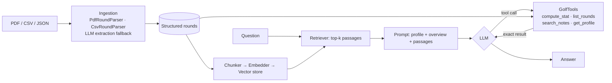

# ⛳ Golf Stats RAG Assistant

Ask questions about your own golf game in plain English. Load your recent rounds (PDF or CSV),
your handicap and other stats, then ask things like:

> *"How many putts did I have on average in the last 10 rounds?"*
> *"What's my best score at Tali?"*
> *"Am I getting better at avoiding penalties?"*
> *"When did I struggle with three-putts, and what did I note about it?"*

Written in **Scala 3**. It uses **Retrieval-Augmented Generation (RAG)** together with **LLM tool
calling**, so number questions get exact answers instead of numbers the model makes up.

```
golf> How many putts did I have on average in the last 10 rounds?

Over your last 10 rounds (20 Jul – 10 Oct) you averaged 32.3 putts. That's close to your
goal of under 32, and 30 putts at Tali on 26 Sep shows you can do it.
```

---

## Why it's not "just RAG"

Plain RAG (embed the documents, retrieve the top‑k, let the LLM answer) is good at *"what did I
write about my driver?"* but bad at *"average putts over 10 rounds"*. Retrieval might return
only 6 of the 10 rounds, and LLMs make arithmetic mistakes. This project uses a **hybrid design**:

| Question type | Handled by | Why |
|---|---|---|
| Numbers: averages, totals, best/worst, trends | `compute_stat` tool → `StatsEngine` | Deterministic, exact, covers *all* matching rounds |
| Qualitative: notes, "when did I…" | Vector retrieval (`search_notes` + context in the prompt) | Semantic search over round descriptions and notes |
| Context: handicap, goals | Profile in the system prompt | Lets the model relate stats to goals |



## Features

- **PDF ingestion** with Apache PDFBox. Two layouts are recognised without AI:
  `Key: value` blocks (one per round) and table rows (`Date Course Score Par Putts ...`).
  For any other layout, the **LLM extracts structured JSON**, and every row is still
  validated by the same rules.
- **CSV ingestion** with flexible headers (`Strokes`/`Score`, `FIR`/`Fairways`, `Penalty strokes`, …), `,` or `;`
  delimiters, quoted fields, Finnish date format `12.10.2026`, and fairways written as `7/14`.
- **Handicap** from a profile JSON, from the PDF header (`Handicap index: 14,2`) or from `--handicap`.
- **Pluggable embeddings**: an offline hashing embedder (no setup, deterministic) or real
  semantic embeddings from Ollama (`nomic-embed-text`).
- **Pluggable LLMs**: Gemini (free tier), Groq, OpenAI, Claude, or a local Ollama model. Any
  OpenAI-compatible API works, with automatic retry when a free tier's rate limit is hit.
- **Agent loop** with multi-step tool calls, error feedback to the model and conversation memory
  for follow-up questions.
- **Offline mode**: with no LLM at all, a keyword intent parser still answers common stat questions.
- **Tests** (munit), including a fake LLM to test the agent loop and a real PDF round trip.

## Stats you can ask about

`score`, `to_par`, `putts`, `putts_per_hole`, `penalties`, `fairways_hit`, `fairway_pct`, `gir`, `gir_pct`.
Each one can be an average, total, min, max, median, count or trend, filtered by last N
rounds, course or date range.

---

## Getting started in IntelliJ IDEA (Community 2025.2)

> Note: *2025.2.51* is the version of IntelliJ's **Scala plugin**. The Scala **language** version used here
> is **Scala 3.3.6 (LTS)**, set in `build.sbt`. sbt downloads it automatically.

1. **Install the Scala plugin** if you haven't: *Settings → Plugins → Marketplace → "Scala"*.
2. **Open the project**: *File → Open…* → select the `golf-stats-rag` folder (the one with `build.sbt`) →
   *Open as Project*. IntelliJ detects sbt and imports it. The first import downloads dependencies and takes a minute or two.
3. **JDK**: if asked, choose JDK 17 or 21 (*File → Project Structure → Project → SDK*; IntelliJ can download one).
4. **Run the tests**: right-click `src/test/scala` → *Run 'All Tests'*. You should get 19 passing tests.
5. **Run the app**: open `src/main/scala/golfrag/Main.scala` and click the green ▶ next to `object Main`.
   It starts in offline mode with the sample data. Type questions into the Run console.

### Using a real LLM

**Option A: Google Gemini (free, recommended to start).**
1. Get a free API key at <https://aistudio.google.com/apikey> (sign in with Google, then *Create API key*; no credit card needed).
2. In IntelliJ: *Run → Edit Configurations… → Main → Environment variables* → add `GEMINI_API_KEY=your-key`.
3. Run `Main`. It detects the key and picks the newest available Gemini *flash* model automatically
   (or set `LLM_MODEL` to choose one). Free tiers allow only a few requests per minute. If you hit the
   limit, the app waits and retries by itself.

**Option B: Groq (free).** Key from <https://console.groq.com/keys> → `GROQ_API_KEY=...`
(default model `llama-3.3-70b-versatile`; override with `LLM_MODEL`).

**Option C: Claude (paid, best answers).** Key from <https://console.anthropic.com> → `ANTHROPIC_API_KEY=...`
(optional `LLM_MODEL` to choose the model). OpenAI also works with `OPENAI_API_KEY`.

**Option D: Ollama (free, runs locally, no key).** Install from <https://ollama.com>, then
`ollama pull llama3.1` and use program arguments `--llm ollama`. For semantic embeddings, also run
`ollama pull nomic-embed-text` and add `--embedder ollama`.

If several keys are set, pick one with `--llm gemini|groq|openai|anthropic|ollama|offline`.
Never commit your API key: keep it in the run configuration (`.idea/` is git-ignored).

### Using your own data

Program arguments (*Run → Edit Configurations… → Program arguments*):

```
--rounds C:\Users\me\Documents\golf\my-rounds.pdf --handicap 14.2
--rounds rounds-2026.csv --profile data/profile.json --verbose
```

`--verbose` shows which passages were retrieved and which tools the model called. This is useful for
seeing how it works, and for demos.

**CSV format** (header names are flexible, only `date, course, score, putts` are required):
```csv
date,course,score,par,putts,penalties,fairways_hit,fairways_possible,gir,holes,notes
2026-10-12,Tali,84,72,31,1,8,14,7,18,"Driver straight, lag putting good"
```

**PDF format**: see `data/sample-rounds.pdf`. Any text-based PDF works. If the layout isn't
recognised and an LLM is configured, the LLM extracts the rounds. (Scanned images need OCR first.)

### From the command line (optional)

```bash
sbt test
sbt run
sbt "run --rounds data/sample-rounds.pdf --ask \"Average putts in my last 10 rounds?\""
sbt "runMain golfrag.SampleData"     # regenerate the sample CSV + PDF
```

---

## Project structure

```
src/main/scala/golfrag/
├── Main.scala              CLI, argument parsing, chat loop
├── DataLoader.scala        Picks a parser per file type, merges and dedupes rounds
├── SampleData.scala        Demo rounds + CSV/PDF writers
├── model/Model.scala       Round, PlayerProfile, GolfData
├── ingest/                 CSV, PDF, profile JSON, LLM-based extraction fallback
├── stats/StatsEngine.scala Metrics, aggregations, filtering, trend (least squares)
├── rag/                    Chunker, Embedder trait, HashingEmbedder, vector store, Retriever
├── llm/                    Provider-neutral chat + tool model, Anthropic and Ollama clients
└── agent/                  GolfAssistant (RAG + tool loop), GolfTools, OfflineAssistant
```

## Ideas for extending it

- Hole-by-hole data (birdies, scrambling, up-and-down %) and strokes-gained style metrics.
- Persist the vector index (e.g. SQLite or pgvector) instead of rebuilding it on every start.
- A small web UI (http4s or Play) or a chart of trends.
- Evaluation set: question → expected answer, to measure accuracy across LLMs and prompts.

## For your CV

> **Golf Stats RAG Assistant (Scala 3).** A question-answering assistant over personal golf data, using
> retrieval-augmented generation and LLM tool calling. Built PDF/CSV ingestion (Apache PDFBox) with
> an LLM-based structured-extraction fallback, a vector-retrieval pipeline with pluggable embedders,
> and a provider-neutral agent loop supporting Gemini, Claude, OpenAI-compatible APIs and local Ollama models. Number questions go
> to a deterministic stats engine through tool calls, so answers are exact. Covered by a munit test
> suite that includes a scripted fake LLM.

*Skills:* Scala 3, functional design (ADTs, enums, `Either` error handling), sbt, REST/JSON integration,
LLM tool use, RAG, embeddings and vector search, PDF parsing, unit testing.
